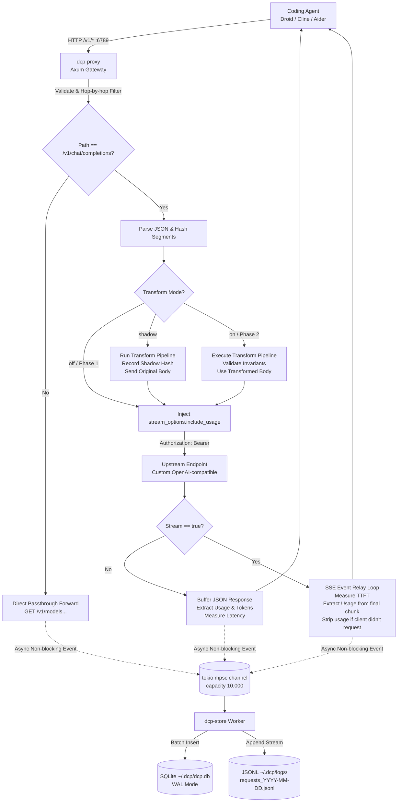

# Đặc Tả Kỹ Thuật (Technical Specification) - Droid Cache Proxy (`dcp`)

- **Tên dự án:** Droid Cache Proxy (`dcp`)
- **Ngôn ngữ:** Rust (2021 Edition)
- **Kiến trúc:** Asynchronous Reverse Proxy (Tokio + Axum + Reqwest)
- **Cổng mặc định:** `127.0.0.1:6789`

---

## 1. Kiến Trúc Tổng Thể & Sơ Đồ Thành Phần

Dự án được tổ chức theo mô hình **Cargo Workspace** gồm 6 crates chuyên biệt nhằm đảm bảo tính module hóa, dễ kiểm thử và tách bạch trách nhiệm:

```text
crates/
├── dcp/                # Binary CLI (serve, stats, analyze, report)
├── dcp-core/           # Types, Models, Config, OpenAI Protocol Structs, Error types
├── dcp-proxy/          # HTTP Gateway Server, Forwarder, SSE Relay, Latency Tracker
├── dcp-store/          # Async Logger, SQLite Pool, JSONL Appender, Log Rotator
├── dcp-transform/      # Canonicalizer, Prefix Aligner, Volatile Extractor, Safety Check
└── dcp-analyze/        # Offline Diff Engine, Divergence Finder, Report Generator
```

### 1.1. Sơ đồ luồng dữ liệu (Data Flow Diagram)



---

## 2. Chi Tiết Luồng Xử Lý Request / Response

### 2.1. Tiếp nhận Request & Xử lý Header
1. **Lắng nghe:** Axum server bind `127.0.0.1:6789`.
2. **Lọc Header Hop-by-hop:** Proxy loại bỏ các header kết nối hop-by-hop không được chuyển tiếp theo chuẩn RFC 7230:
   - `Connection`, `Keep-Alive`, `Proxy-Authenticate`, `Proxy-Authorization`, `TE`, `Trailers`, `Transfer-Encoding`, `Upgrade`.
   - `Host` header được thay bằng host của upstream URL.
3. **Ghi đè API Key (Quyết định D4):**
   - Bất kể header `Authorization` client gửi lên là gì, proxy luôn ghi đè:
     `Authorization: Bearer <DCP_API_KEY>` (lấy từ biến môi trường quy định tại `upstream.api_key_env`).
   - Nếu biến môi trường rỗng hoặc không tồn tại, proxy fail-fast ngay lúc khởi động: dừng tiến trình với mã lỗi `2` và thông báo hướng dẫn, theo đúng `docs/04-contracts/config.schema.md` §3 và `docs/04-contracts/api.md` §3.1. Proxy không khởi động ở trạng thái thiếu key, nên không tồn tại nhánh trả `500` lúc runtime cho lỗi này.
4. **Phân loại Route (Quyết định D3):**
   - Nếu `path != "/v1/chat/completions"`: Chuyển tiếp nguyên trạng method, query parameters và body sang upstream. Ghi nhận thời gian hoàn thành vào log metadata.
   - Nếu `path == "/v1/chat/completions"`: Chuyển tiếp vào pipeline xử lý chuyên sâu.

### 2.2. Xử lý Payload `/v1/chat/completions` & Session Hashing
1. **Trích xuất / Khởi tạo `session_id`:**
   - Kiểm tra header `x-dcp-session`. Nếu có, sử dụng chuỗi này làm `session_id`.
   - Nếu không có header: Tính hash SHA-256 từ sự kết hợp của:
     `System Prompt` + `Tools Definition JSON` + `First User Message Content`.
     Tất cả các request trong cùng một tác vụ coding agent thường có 3 thành phần mở đầu này cố định, cho phép nhóm tự động thành 1 session.
2. **Segment Hashing (Phục vụ đo điểm gãy tiền tố):**
   - Request được phân rã thành các segment theo quy ước cố định:
     - `Segment 0`: Message `system` đầu tiên (nếu không có system message, segment 0 là phần tử đầu của `messages`).
     - `Segment 1`: Toàn bộ mảng `tools` gộp thành một khối JSON duy nhất (không tách từng tool).
     - `Segment 2..k`: Từng message còn lại trong mảng `messages` theo đúng thứ tự (bỏ qua message đã dùng làm Segment 0).
   - Lưu ý: golden fixture `02_prefix_align` không có system message nên Segment 0 của nó là message `user` đầu tiên.
   - Tính SHA-256 hash độc lập cho từng segment: $h_0, h_1, \dots, h_k$.
   - Tính `prefix_hash` tích lũy (Cumulative Prefix Hash):
     $$\text{PrefixHash}_0 = h_0$$
     $$\text{PrefixHash}_i = \text{SHA256}(\text{PrefixHash}_{i-1} \parallel h_i)$$
   - Lưu trữ mảng segment hashes này để phục vụ so sánh giữa các turn liên tiếp.

### 2.3. Xử lý Streaming (SSE Relay) & Trích Xuất Usage (Quyết định D5)
Đây là logic cốt lõi đảm bảo đo được số liệu cache hit ở Giai đoạn 1 mà không phá vỡ giao thức:

1. **Kiểm tra cờ `include_usage` ban đầu:**
   - Đọc trường `body.stream_options.include_usage`.
   - Lưu cờ boolean: `client_requested_usage = (include_usage == Some(true))`.
2. **Tự động chèn `include_usage`:**
   - Nếu `stream == true` và `client_requested_usage == false`:
     - Proxy cập nhật JSON body: `body["stream_options"]["include_usage"] = true`.
     - Cập nhật lại header `Content-Length` (hoặc chuyển sang chunked).
3. **Relay luồng SSE về Client & Đo TTFT:**
   - Sử dụng client `reqwest` nhận stream phản hồi từ upstream dạng `bytes_stream`.
   - Đánh dấu mốc thời gian $T_0$ lúc gửi request, $T_1$ lúc nhận chunk đầu tiên $\to$ **$\text{TTFT} = T_1 - T_0$**.
   - Parse luồng bytes thành các event SSE (dòng bắt đầu bằng `data: `).
4. **Xử lý Chunk cuối cùng chứa Usage:**
   - Khi gặp chunk JSON chứa trường `"usage"`:
     - Trích xuất: `prompt_tokens`, `completion_tokens`, `total_tokens`.
     - Trích xuất `cached_tokens`: Ưu tiên `usage.prompt_tokens_details.cached_tokens`, fallback `usage.prompt_cache_hit_tokens`.
     - Chuyển toàn bộ số liệu này sang kênh log worker.
     - **Lọc chunk (Filter out):** Nếu `client_requested_usage == false`, proxy **không forward chunk usage này cho client**, mà chỉ gửi event `data: [DONE]` để kết thúc stream theo đúng kỳ vọng của client ban đầu.

---

## 3. Hệ Thống Lưu Trữ Bất Đồng Bộ (Zero-Overhead Async Storage)

Để đảm bảo P99 latency của proxy không bị ảnh hưởng bởi việc ghi đĩa hoặc truy vấn database:

### 3.1. Kênh truyền dẫn nội bộ (In-Memory Channel)
- Sử dụng `tokio::sync::mpsc::channel<LogEvent>(10000)`.
- Khi một request hoàn thành, worker HTTP chỉ đẩy struct `LogEvent` vào channel bằng lệnh `try_send()`. Thao tác này tiêu tốn dưới **1 microsecond**.
- Nếu channel bị đầy (nghẽn đĩa nặng), proxy ghi warning log và drop event thay vì làm treo request của người dùng (nguyên tắc an toàn: không bao giờ chặn luồng chính).

### 3.2. Background Storage Worker
Một task chạy nền độc lập (`tokio::spawn`) tiêu thụ các event từ channel:
1. **Ghi SQLite (`dcp-store`):**
   - SQLite được cấu hình ở chế độ `PRAGMA journal_mode = WAL;` và `PRAGMA synchronous = NORMAL;`.
   - Thu gom các event và thực hiện **Batch Insert** định kỳ mỗi 500ms hoặc khi gom đủ 50 records bằng 1 transaction duy nhất:
     `INSERT INTO requests (...) VALUES (...);`
     `INSERT INTO segments (...) VALUES (...);`
2. **Ghi JSONL xoay vòng theo ngày:**
   - Mở file `~/.dcp/logs/requests_YYYY-MM-DD.jsonl` ở chế độ append.
   - Ghi mỗi request thành đúng 1 dòng JSON chứa: `request_id`, `timestamp`, `session_id`, `raw_request`, `raw_response`, `transformed_request` (nếu có).
   - Quyền hạn file được thiết lập nghiêm ngặt `0600` (chỉ user hiện tại có quyền đọc/ghi).

---

## 4. Công Cụ Phân Tích Log Giai Đoạn 2 (`dcp-analyze`)

Bộ phân tích chạy dưới dạng lệnh CLI (`dcp analyze`) hoặc thư viện offline:

### 4.1. Thuật toán phát hiện phân kỳ tiền tố (Prefix Divergence Algorithm)
Với mỗi phiên làm việc (`session_id`), lấy danh sách các request được sắp xếp theo thời gian $R_1, R_2, \dots, R_m$:
1. Với mỗi cặp request liên tiếp $(R_n, R_{n+1})$:
2. So sánh danh sách hash từng segment: $S_n = [h_{n,0}, h_{n,1}, \dots]$ và $S_{n+1} = [h_{n+1,0}, h_{n+1,1}, \dots]$.
3. Tìm chỉ mục $i$ nhỏ nhất sao cho $h_{n,i} \neq h_{n+1,i}$.
4. Nếu tìm thấy $i$:
   - Vị trí gãy tiền tố là Segment thứ $i$.
   - Trích xuất nội dung gốc của Segment $i$ từ file JSONL tương ứng để thực hiện `diff` văn bản.
5. Gom nhóm vào bảng lỗi M1 - M6:
   - Nếu $i = 0$ (System prompt) và diff chứa pattern ngày tháng/giờ: Gán nhãn `M1_VOLATILE_TIMESTAMP`.
   - Nếu $i = 1$ (Tools) và các phần tử tools giống nhau nhưng khác thứ tự mảng: Gán nhãn `M2_TOOL_ORDER`.
   - Nếu $i = 1$ (Tools) và schema chỉ khác khoảng trắng/thứ tự key: Gán nhãn `M3_NON_CANONICAL_JSON`.
   - Nếu $i$ xuất hiện ở giữa lịch sử hội thoại: Gán nhãn `M4_MID_HISTORY_INJECTION`.

---

## 5. Pipeline Biến Đổi Tối Ưu Tiền Tố (Transform Pipeline)

Pipeline nằm trong crate `dcp-transform`. Thứ tự thực thi của các bước là **cố định và đơn hướng**:

```text
Input Request Body
       │
       ▼
┌───────────────────────────────┐
│ 1. Canonicalize               │
│    - JSON Schema key sort     │
│    - Whitespace normalization │
│    - Unicode NFC normalize    │
│    - Tools array sort by name │
└──────────────┬────────────────┘
               │
               ▼
┌───────────────────────────────┐
│ 2. Prefix Align               │
│    - Reorder: System -> Tools │
│      -> Stable History        │
│      -> Dynamic Turn          │
│    - Preserve tool_call_id    │
└──────────────┬────────────────┘
               │
               ▼
┌───────────────────────────────┐
│ 3. Volatile Extract (Opt-in)  │
│    - Extract timestamp/git    │
│    - Relocate to dynamic tail │
└──────────────┬────────────────┘
               │
               ▼
┌───────────────────────────────┐
│ 4. Custom Rules Engine        │
│    - User-defined regex/rules │
└──────────────┬────────────────┘
               │
               ▼
┌───────────────────────────────┐
│ 5. Safety Validator           │
│    - Check structural schema  │
│    - Message count invariant  │
│    - Tool call link invariant │
└──────────────┬────────────────┘
               │
               ├── (Pass) ──> Output Transformed Body
               └── (Fail) ──> Fallback to Original Body + Log Warning
```

### 5.1. Chi tiết từng bước biến đổi

#### Bước 1: `canonicalize` (Chuẩn hóa cú pháp)
- **JSON Schema:** Duyệt đệ quy toàn bộ `parameters` của từng tool, sắp xếp các keys trong dictionary theo thứ tự alphabet tăng dần.
- **Tools Array:** Sắp xếp mảng `tools` theo `tool.function.name` (A-Z). Việc này loại bỏ hoàn toàn lỗi gãy prefix do agent framework nạp tool ngẫu nhiên.
- **Unicode:** Chuẩn hóa toàn bộ chuỗi string theo chuẩn Unicode Normalization Form C (NFC).
- **Lưu ý:** Không thay đổi nội dung text của tin nhắn `user` hay `assistant` để tránh làm sai lệch code người dùng viết.

#### Bước 2: `prefix_align` (Căn chỉnh cấu trúc tiền tố)
- Đảm bảo trật tự các khối cấp cao trong prompt tuân theo nguyên lý "Từ Tĩnh Đến Động":
  1. `System Message` (Chỉ thị hệ thống).
  2. `Tools Definitions` (Danh mục công cụ).
  3. `Conversation History` (Các lượt trò chuyện cũ).
  4. `Active Turn` (Lệnh mới nhất).
- **Quy tắc bất biến:** Bảo toàn 100% thứ tự tương đối giữa các message hội thoại. Không bao giờ đảo vị trí giữa `assistant` có `tool_calls` và `tool` message mang kết quả trả về tương ứng.

#### Bước 3: `volatile_extract` (Di dời dữ liệu biến thiên - Cấu hình tùy chọn)
- Quét System Prompt bằng các biểu thức chính quy (Regex) được định nghĩa trước:
  - Timestamp ISO 8601 / RFC 3339 (`\d{4}-\d{2}-\d{2}[T ]\d{2}:\d{2}:\d{2}`).
  - Git commit SHA (`[0-9a-f]{40}`).
- Nếu phát hiện: Trích xuất đoạn text chứa thông tin biến thiên ra khỏi System Prompt, chèn nó vào một block thông tin ngữ cảnh đặt ở cuối User Message gần nhất (Dynamic Context Block).
- Bước này có thể bật/tắt độc lập trong `config.toml` thông qua `transform.volatile_extract = true|false`.

### 5.2. Các Bất Biến An Toàn (Safety Invariants)
Mỗi request sau khi đi qua pipeline transform bắt buộc phải vượt qua hàm `validate_transformed_request(&original, &transformed)`:
1. `transformed.messages.len() == original.messages.len()` (Không được làm mất bất kỳ tin nhắn nào).
2. Mọi `tool_call_id` trong tin nhắn `role == "tool"` phải tồn tại trong tin nhắn `role == "assistant"` đứng ngay trước nó.
3. Thử nghiệm Lũy đẳng: `pipeline.transform(&transformed) == transformed`. Nếu chạy transform lần thứ hai mà payload vẫn thay đổi, hủy bỏ kết quả và fallback về request gốc.

Khi fallback, proxy ghi một trong các mã lỗi sau vào `transform_error` (cột SQLite `requests.transform_error`, trường JSONL `transformed_request.error`):
- `parse_error`: Không parse được JSON body của request gốc.
- `validation_failed`: Vi phạm bất biến an toàn (mất message hoặc lệch liên kết `tool_call_id`).
- `non_idempotent`: Chạy transform lần hai vẫn làm thay đổi payload.
- `custom_rule_error`: Rule regex tùy chỉnh lỗi cú pháp hoặc throw exception.
- `volatile_extract_error`: Lỗi khi bóc tách/di dời khối volatile.

---

## 6. Chiến Lược Xử Lý Lỗi & Khả Năng Chống Chịu (Fault Tolerance)

1. **Upstream Error Forwarding:**
   - Nếu Upstream trả về mã lỗi HTTP (400 Bad Request, 401 Unauthorized, 429 Rate Limit, 500 Server Error): Proxy forward chính xác status code, header và body lỗi đó về client.
   - Ghi nhận trạng thái lỗi vào SQLite (`status = upstream_status`).
2. **Upstream Timeout:**
   - Cấu hình timeout mặc định là 300 giây (phù hợp với các prompt coding lớn cần sinh nhiều code).
   - Nếu hết thời gian chờ, proxy trả về `504 Gateway Timeout` dạng JSON chuẩn OpenAI:
     `{"error": {"message": "Upstream gateway timeout after 300s", "type": "timeout_error"}}`.
3. **Database / Disk Failure:**
   - Nếu SQLite bị khóa hoặc ổ cứng đầy: Kênh mpsc sẽ drop log, in cảnh báo ra console qua `tracing::error!`.
   - **Tuyệt đối không làm crash proxy** hoặc trả lỗi về phía coding agent. Ưu tiên hàng đầu là giữ cho agent tiếp tục làm việc bình thường.

---

## 7. Kế Hoạch Kiểm Thử Chi Tiết (Testing Strategy)

1. **Unit Tests:**
   - `dcp-core`: Test parse cấu hình, validate các giới hạn, chuyển đổi cấu trúc OpenAI JSON.
   - `dcp-transform`: Chạy unit test cho từng module transform với dữ liệu đầu vào cụ thể, xác minh tính lũy đẳng (Idempotence).
   - `dcp-store`: Test ghi batch SQLite, đảm bảo truy vấn rollup metrics tính toán chính xác số token.
2. **Golden File Tests (`fixtures/golden/`):**
   - Đọc các file JSON input mẫu trong `fixtures/golden/*_input.json`.
   - Chạy qua pipeline transform.
   - So sánh từng byte với `fixtures/golden/*_expected.json`.
3. **Mock Upstream Integration Tests (Wiremock):**
   - Dựng mock HTTP server giả lập upstream bằng crate `wiremock`.
   - Kiểm thử hành vi forward header, ghi đè API key.
   - Kiểm thử SSE stream: Mock trả về từng chunk kèm usage ở chunk cuối, xác minh proxy tính đúng TTFT và lọc bỏ usage chunk khi client không yêu cầu.
4. **Benchmark Hiệu Năng (Criterion):**
   - Viết benchmark đo lường thời gian thực thi của Transform Pipeline: Mục tiêu dưới 1ms cho payload 100KB JSON.
   - Đo throughput và memory footprint của proxy dưới tải 100 concurrent SSE connections.
